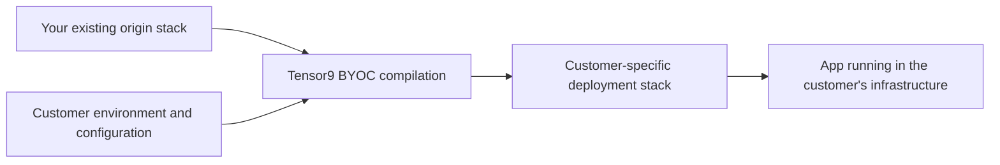

# Tensor9 skills

Skills for working with **Tensor9 BYOC** in [Codex](https://developers.openai.com/codex/) and [Claude Code](https://code.claude.com/docs/en/overview).

The skill is called **`tensor9-byoc`**. It gives your coding agent Tensor9-specific knowledge, reference material, and procedures for helping you deliver and operate software in customer environments. This repository is the home for that assistance across the BYOC lifecycle.

[Tensor9 documentation](https://docs.tensor9.com/) · [BYOC overview](https://docs.tensor9.com/byoc/index) · [Install the CLI](https://docs.tensor9.com/byoc/cli/install)

## What is Tensor9?

Tensor9 is a software adaptation platform. It helps software and AI vendors adapt their existing products to different clouds and enterprise environments.

An enterprise customer may need your product to run in its own cloud account or data center, use its existing databases, or meet its networking and access requirements. Serving those customers can otherwise mean maintaining separate infrastructure and operational procedures for each deployment. Tensor9 works from your existing application and infrastructure definitions to produce deployments suited to each supported environment.

## What is Tensor9 BYOC?

**BYOC** means **bring your own cloud**. Tensor9 BYOC lets a software vendor deliver and operate its product in infrastructure controlled by its customers, including supported AWS, Azure, Google Cloud, and on-premises environments.

You maintain an **origin stack**: the infrastructure definition for your product. Tensor9 compiles it into a **deployment stack** for a particular customer's environment and configuration. The resulting installation runs in a customer-hosted **appliance**.



This extends beyond the initial deployment. Tensor9 BYOC provides workflows for releases and upgrades, observability, remote operations, and customer control over maintenance and vendor access. Per-customer configuration can include ingress, controller connectivity, and customer-provided services.

When a customer's environment uses different services, Tensor9's service adapters can translate supported infrastructure or API operations to their equivalents. Compatibility depends on the service mapping and the operations your application uses. Review the [service adapter documentation](https://docs.tensor9.com/byoc/service-adapters/overview) for the relevant mapping and its limitations.

### Terms you will encounter

| Term | Meaning |
| --- | --- |
| Vendor | The organization delivering its software through Tensor9 BYOC. |
| Customer | The organization running that software in its own infrastructure. |
| App | The product a vendor delivers to customers. |
| Origin stack | Your existing application infrastructure definition, used as the source for customer deployments. |
| Deployment stack | The infrastructure definition Tensor9 generates for a particular target environment. |
| Appliance | The customer-hosted environment in which an app runs. |
| Install | A particular app running on a particular appliance. |
| Control plane | The vendor's management environment for compilation, releases, and appliance operations. |

See [How Tensor9 BYOC works](https://docs.tensor9.com/byoc/fundamentals/how-tensor9-works) and [Key concepts](https://docs.tensor9.com/byoc/fundamentals/key-concepts) for the full model.

## What the skill helps you do

Use `tensor9-byoc` for Tensor9 BYOC work throughout your project. Its current detailed procedures cover:

- **Understand your deployment.** Explain origin stacks, customer installs, service choices, and how they relate to your existing infrastructure.
- **Install and check the Tensor9 CLI.** Identify an existing installation or help you choose an installation method and destination.
- **Prepare Terraform and OpenTofu source.** Find the decisions needed to make your existing stack suitable for customer installs: domains, regions, secret ownership, and resource naming.
- **Evaluate external dependencies.** Investigate services used by your application and help you decide what customer installs should retain, replace, or omit.
- **Apply your decisions.** Add approved annotation comments and distinguish those changes from feature configuration or source repairs.
- **Review Terraform problems.** Trace optional resources and their consumers, explain confirmed problems, and propose a focused repair for review.

For other BYOC tasks, the skill uses the current product documentation and public CLI help to establish the appropriate workflow. Installation, releases, upgrades, observability, and operations are part of its broader purpose; detailed procedures and behavioral qualification for those tasks will continue to expand.

### Start with a concrete request

For example:

> Explain how our Terraform stack would become customer-specific installs. Identify the choices we need to make before changing anything.

> Review `./terraform` for Tensor9 BYOC. Ask who should supply the external-service secrets, and leave unknown answers open.

> Our customer wants to use its existing PostgreSQL database. Explain the BYOC configuration and documentation we should review.

> Help me install the Tensor9 CLI, then explain the next steps for working with our existing stack.

The agent should use your actual source and choices. A dependency appearing in a reference catalog is a reason to investigate it; it does not establish what your application should do.

## Install the skill

Install the complete folder for your coding agent. Each package includes `SKILL.md`, supporting references, a versioned Considerations catalog, and its Python helper. Copying only `SKILL.md` leaves the package incomplete.

Clone this repository somewhere outside your application source directory:

```sh
git clone https://github.com/tensor9ine/tensor9-skills.git
```

Then open a terminal in your application project and set the absolute path to that clone:

```sh
TENSOR9_SKILLS_SOURCE="/absolute/path/to/tensor9-skills"
```

### Codex

Install the project skill:

```sh
mkdir -p .agents/skills
test ! -e .agents/skills/tensor9-byoc &&
  cp -R "$TENSOR9_SKILLS_SOURCE/codex/skills/tensor9-byoc" .agents/skills/
```

Start a new Codex session in the project. Ask a BYOC question normally, or invoke the skill explicitly:

```text
$tensor9-byoc Help me prepare ./terraform for customer installs. Inspect it and ask your first question before editing.
```

Codex discovers project skills from `.agents/skills`. See the [Codex skills documentation](https://learn.chatgpt.com/docs/build-skills) for other installation locations and invocation details.

### Claude Code

Install the project skill:

```sh
mkdir -p .claude/skills
test ! -e .claude/skills/tensor9-byoc &&
  cp -R "$TENSOR9_SKILLS_SOURCE/claude/skills/tensor9-byoc" .claude/skills/
```

Start a new Claude Code session in the project. Ask a BYOC question normally, or invoke:

```text
/tensor9-byoc Help me prepare ./terraform for customer installs. Inspect it and ask your first question before editing.
```

See the [Claude Code skills documentation](https://code.claude.com/docs/en/skills) for discovery and installation details.

If the destination already exists, the copy command above stops. Review the existing package and preserve any local changes before updating it. If you installed an earlier package named `tensor9-byoc-onboarding`, replace that installation with `tensor9-byoc` after preserving your changes, so the agent does not discover both versions.

## Install the Tensor9 CLI

The skill can explain BYOC and inspect source before you configure a Tensor9 account. Python 3 is needed to run the bundled Considerations helper. The public `tensor9` CLI enables live catalog retrieval and the product's CLI workflows.

On macOS or Linux with Homebrew 7 or later:

```sh
brew tap tensor9ine/tensor9
brew trust tensor9ine/tensor9
brew install tensor9
tensor9 version
```

For earlier Homebrew versions, omit the `brew trust` command. The CLI bundles its Java runtime. For the shell installer, supported architectures, WSL, and troubleshooting, follow [Install the Tensor9 CLI](https://docs.tensor9.com/byoc/cli/install).

The agent's bundled installation guide covers checking an existing executable, choosing an installation destination outside your application workspace, and obtaining your agreement before installing. Installing the CLI is separate from account authentication and control-plane setup. A local source review does not require running those setup steps.

## Working with the skill

### Your choices remain explicit

The compiler can transform infrastructure, but it cannot know who should supply an API key or whether an external service belongs in a customer install. The skill asks you to make those choices. Unknown answers stay open, and existing approved answers should be reused when their underlying assumptions remain valid.

For Terraform, the skill records applicable choices in `#@` annotation comments. It reports those separately from configuration changes and source repairs, which can affect behavior. Review the proposed diff before accepting a repair or changing a deployment configuration.

The current preparation workflow works on local source. Publishing a stack, creating a release, applying infrastructure, or changing a live environment requires its own requested workflow and authorization. Keep credentials out of prompts, source files, and reports. Your coding agent processes the source it reads according to its configured provider and data-handling settings.

### Considerations evolve with the product

The shared **Considerations** catalog describes external services and the questions their use can raise for customer installs. Both agent packages use the same versioned catalog and common Terraform mistakes reference.

The bundle currently includes catalog **1.0.0**. Its helper can retrieve newer generic reference metadata through your installed Tensor9 CLI and selected controller profile. It automatically attempts a refresh when its cache is missing or more than 24 hours old; it retains usable cache or bundled data if refresh fails. Offline review can use the bundled catalog.

The agent should identify the catalog version, source, and refresh outcome when reporting its findings. A bundled or cached result must be described as such. The helper sends no application files or your answers as part of catalog retrieval. Catalog guidance informs investigation; your decisions determine changes to your application.

For profile selection, explicit refresh, offline mode, cache validation, and limitations, see [Using Considerations](codex/skills/tensor9-byoc/references/considerations-usage.md). Both provider packages carry the same reference.

## Documentation by task

| Task | Product documentation |
| --- | --- |
| Understand Tensor9 BYOC | [Overview](https://docs.tensor9.com/byoc/overview/what-is-tensor9) · [Key concepts](https://docs.tensor9.com/byoc/fundamentals/key-concepts) |
| Try an existing Terraform stack | [Terraform/OpenTofu quick start](https://docs.tensor9.com/byoc/getting-started/quick-start-terraform) |
| Prepare your origin stack | [Terraform/OpenTofu](https://docs.tensor9.com/byoc/origin-stack/terraform) |
| Choose target services | [Service adapters](https://docs.tensor9.com/byoc/service-adapters/overview) |
| Configure customer differences | [Customizations](https://docs.tensor9.com/byoc/customizations/overview) |
| Work with the command line | [CLI installation](https://docs.tensor9.com/byoc/cli/install) · [Common workflows](https://docs.tensor9.com/byoc/cli/common-workflows) |
| Guide a customer through installation | [Customer getting started](https://docs.tensor9.com/byoc/customer/getting-started/overview) |
| Manage customer upgrades | [Updates and upgrades](https://docs.tensor9.com/byoc/customer/operations/updates-and-upgrades) |
| Investigate a customer environment | [Monitoring](https://docs.tensor9.com/byoc/customer/operations/monitoring) · [Troubleshooting](https://docs.tensor9.com/byoc/customer/operations/troubleshooting) |

## Package status and provenance

Native behavioral qualification is in progress, using fresh cloud-build environments with real Codex sessions first, followed by Claude Code. Package checks alone do not establish that an agent correctly discovers the skill or handles a customer workflow. No completed native qualification is claimed for this release.

[`public-source-manifest.json`](public-source-manifest.json) records the source revision and SHA-256 hashes of the eight resources in each provider package. Use it to identify the exact files you installed. The provider-specific entrypoints share the same supporting references and catalog.

## Feedback

For skill problems or documentation improvements, [open an issue](https://github.com/tensor9ine/tensor9-skills/issues) with your agent and version, the skill revision, the task you attempted, and a redacted description of the result. Include only the minimum source example needed to reproduce it. Keep credentials, customer identifiers, and private infrastructure details out of public issues.

For help with Tensor9 BYOC itself, see [Tensor9 support](https://docs.tensor9.com/byoc/support/getting-help).
